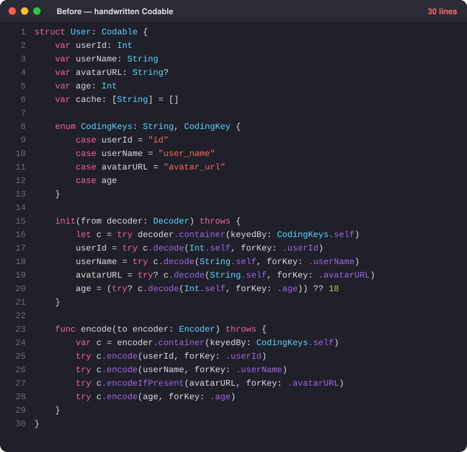
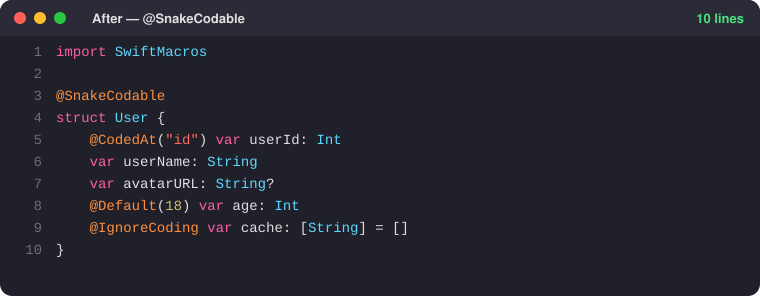

# SwiftMacros

Macro Swift tự sinh `Codable` cho JSON snake_case — kèm cách dùng với app **JSON Export**.

<table>
  <tr>
    <th>Trước — viết tay</th>
    <th>Sau — <code>@SnakeCodable</code></th>
  </tr>
  <tr>
    <td valign="top"></td>
    <td valign="top"></td>
  </tr>
</table>

## Cài đặt (Swift Package Manager)

```swift
dependencies: [
    .package(url: "https://github.com/k2tam/SwiftMacros.git", branch: "main"),
],
targets: [
    .target(name: "YourApp", dependencies: [
        .product(name: "SwiftMacros", package: "SwiftMacros"),
    ]),
]
```

Hoặc trong Xcode: **File ▸ Add Package Dependencies…** rồi dán URL repo.

Yêu cầu: Swift 6.x, swift-syntax 604+ (đã khai báo trong `Package.swift`).

## 1. Macro làm gì?

Gắn `@SnakeCodable` lên struct, macro tự sinh `CodingKeys`, `init(from:)`, `encode(to:)` và conform `Codable`. Tên camelCase tự đổi thành snake_case.

```swift
import SwiftMacros

@SnakeCodable
struct User {
    var userName: String?     // "user_name"
    var avatarURL: String?    // "avatar_url"
}
```

## 2. Các attribute phụ

| Attribute | Tác dụng |
|---|---|
| `@CodedAt("id")` | Chỉ định key JSON riêng (khi key không theo snake_case) |
| `@Default(18)` | Thiếu key hoặc decode lỗi → dùng giá trị mặc định |
| `@IgnoreCoding` | Bỏ qua property, không encode/decode |
| `Type?` | Optional: thiếu key, `null` hoặc sai kiểu → `nil` |

Computed property tự động bị bỏ qua.

> Macro chạy an toàn: mọi property phải là optional (`Type?`) hoặc có `@Default`. Server không trả key, trả `null` hay sai kiểu → `nil`/default, model **không bao giờ decode lỗi**. Khai báo `var x: Int` (không `?`, không `@Default`) sẽ báo lỗi compile kèm fix-it "Đổi thành Int?".

## 3. Ví dụ đầy đủ

```swift
@SnakeCodable
struct User {
    var userName: String?
    @CodedAt("id") var userId: Int?
    @Default(18) var age: Int
    var avatarURL: String?
    @IgnoreCoding var cache: [String] = []
}
```

```json
{
  "user_name": "tam",
  "id": 42,
  "avatar_url": null
}
```

```swift
// thiếu "age" → age = 18
let user = try JSONDecoder().decode(User.self, from: data)
let out  = try JSONEncoder().encode(user)
```

## 4. Dùng với JSON Export (sinh model tự động)

1. Mở `JSONExport-SwiftMacros/JSONExport.xcodeproj`, chạy app.
2. Dán JSON vào ô bên trái, đặt **Root class name**.
3. Chọn ngôn ngữ **Swift - Struct - SnakeCodable (Macro)** (app chọn sẵn mặc định).
4. Bấm **Generate**, rồi **Save** hoặc **Copy** file `.swift` vào project.

```swift
// JSON: { "user_name": "tam", "userId": 42 }
import Foundation
import SwiftMacros

@SnakeCodable
struct User {
    var userName: String?                 // khớp snake_case → không cần @CodedAt
    @CodedAt("userId") var userId: Int?   // key lệch → tự thêm @CodedAt
}
```

App chỉ thêm `@CodedAt` khi key JSON khác kết quả đổi snake_case của tên property. Mọi property sinh ra là optional.

## 5. Lưu ý nhanh

- Quy tắc đổi tên: `avatarURL` → `avatar_url`, `userURLString` → `user_url_string`.
- **Không** đặt `keyDecodingStrategy = .convertFromSnakeCase` (hay bên encoder) — key đã là snake_case.
- Property optional decode bằng `try?`: sai kiểu sẽ thành `nil`, không báo lỗi.
- Encode bỏ qua optional `nil` (không ghi `null`).
- Code sinh ra là `internal`; macro sinh `init(from:)` nên mất memberwise init mặc định.
- Mỗi dòng một property (`var a: Int, b: Int` chỉ map `a`).
- Chỉ dùng cho `struct`.
- Xem code sinh ra: chuột phải `@SnakeCodable` ▸ **Expand Macro**.
- Lỗi "macro not trusted"? Build lại và bấm **Trust**.

## License

[MIT](LICENSE) © k2tam
